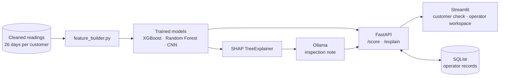

# ⚡ GridGuard: Electricity Theft Detection

> Machine learning and explainable AI for finding suspicious electricity consumption patterns in smart-meter data, with local AI-written inspection notes.


---

## Table of contents

- [Overview](#overview)
- [Features](#features)
- [Architecture](#architecture)
- [Results](#results)
- [How it works](#how-it-works)
- [Project structure](#project-structure)
- [Quick start](#quick-start)
- [Docker](#docker)
- [Configuration](#configuration)
- [API reference](#api-reference)
- [Dashboard](#dashboard)
- [Security and privacy](#security-and-privacy)
- [Limitations and responsible use](#limitations-and-responsible-use)
- [Troubleshooting](#troubleshooting)
- [Roadmap](#roadmap)
- [License and author](#license-and-author)

---

## Overview

Non-technical losses (electricity theft, meter tampering, and billing errors) are a major cost for electricity utilities. GridGuard ranks customers by how closely their 26-day consumption pattern resembles past cases labelled as theft, so inspection teams can prioritize visits.

**GridGuard is a decision-support tool.** A high risk score is a reason to verify a customer's meter, not proof of theft.

## Features

- **Feature engineering** on 26 days of readings: level and spread, zero-reading runs, sudden drops and jumps, per-day outlier flags, deviation from each customer's own average, first-half versus second-half change, and linear trend.
- **Four models compared** with stratified 5-fold cross-validation and a held-out test set: Logistic Regression (baseline), Random Forest, XGBoost, and a hybrid 1D-CNN plus dense network (TensorFlow/Keras).
- **Explainable AI** with SHAP TreeExplainer. Each score comes with the features that raised or lowered it.
- **Local AI notes** with Ollama (`llama3.2:3b`). Each note is three sentences built only from computed facts, with a rule-based template as a fallback when Ollama is offline.
- **FastAPI service** for scoring, explanations, and operator-only customer records (SQLite).
- **Streamlit app** with a public self-check, where a customer enters 26 days of readings, and a password-protected operator workspace for customer entry, saved records, and an AI assistant.
- **MLflow tracking** for every training run.
- **Docker Compose** setup that runs the API, the dashboard, and Ollama in separate containers.

## Architecture



## Results

The dataset contains **25,822 customers**, about **8.1% labelled theft** (`FLAG = 1`). The results below come from one stratified 80/20 split (seed 42) at a decision threshold of 0.5.

### Held-out test set

| Model | Precision | Recall | F1 | ROC-AUC | PR-AUC |
|---|---|---|---|---|---|
| **Random Forest** | **0.921** | 0.306 | 0.459 | 0.838 | 0.510 |
| XGBoost | 0.251 | **0.623** | 0.358 | 0.836 | **0.512** |
| Hybrid 1D-CNN | 0.196 | 0.666 | 0.302 | 0.800 | 0.465 |
| Logistic Regression | 0.098 | 0.788 | 0.174 | 0.638 | 0.125 |

### 5-fold stratified cross-validation (training data only)

| Model | CV PR-AUC (mean) | CV PR-AUC (std) |
|---|---|---|
| Random Forest | 0.528 | ± 0.005 |
| XGBoost | 0.509 | ± 0.011 |
| Logistic Regression | 0.119 | ± 0.004 |

**How to read these numbers**

- Random Forest is the most precise at this threshold. When it flags a customer, it was right about 92% of the time on the test set, but it finds only about 31% of theft cases. That suits expensive inspections.
- XGBoost finds more theft (about 62%) at lower precision.
- A random ranking scores a PR-AUC near the theft rate (about 0.08), so every tree model is well above chance.
- Differences below about 0.01 PR-AUC are within run-to-run noise.
- The files in `Models/` (`model_comparison_results.csv`, `cv_results.csv`) are the source of truth. Re-run `training.py` to reproduce them.

### Top SHAP drivers (mean |SHAP|, from the training run)

| Rank | Feature | Meaning | Mean \|SHAP\| |
|---|---|---|---|
| 1 | `consumption_mean` | Average daily consumption (kWh) | 0.0190 |
| 2 | `consumption_total` | Total consumption over 26 days | 0.0179 |
| 3 | `second_half_mean` | Average over days 14–26 (drop detection) | 0.0155 |
| 4 | `consumption_max` | Peak single-day usage | 0.0140 |
| 5 | `consumption_median` | Robust baseline | 0.0138 |
| 6 | `first_half_mean` | Average over days 1–13 | 0.0135 |

Zero-run features (`longest_zero_streak`) and drop counts (`sudden_decrease_days`) also rank high in the explanations.

## How it works

### Input

- `customer_id`
- `day_1` to `day_26`: daily consumption in kWh, non-negative
- `FLAG` (0 or 1): required for training only

### Features

`src/feature_builder.py` produces the same features for training and serving:

| Group | Examples |
|---|---|
| Level and spread | mean, median, std, min, max, range, total, IQR, coefficient of variation, peak-to-average ratio |
| Outliers | per-day IQR flags, total outliers, outlier ratio |
| Deviation | per-day deviation from the customer's own mean, high-deviation days |
| Changes | average daily change, largest drop and jump, sudden increase and decrease days |
| Zeros and lows | zero-day count and ratio, longest zero run, low-consumption days |
| Halves and trend | first-half and second-half means, change ratio, linear trend slope |

The saved feature list is in `Models/feature_cols.json`.

### Models

- **Logistic Regression:** balanced class weights. Baseline only.
- **Random Forest:** 300 trees, minimum leaf size 2, balanced subsample weights.
- **XGBoost:** 400 trees, depth 5, `scale_pos_weight` set from the training class ratio.
- **Hybrid 1D-CNN:** one branch reads the 26-day shape (each day divided by the customer's own average), and a second branch reads the engineered features. Training uses early stopping on validation PR-AUC.

All classical models sit in a pipeline with median imputation and robust scaling, fitted on training data only.

### Served model

The API scores customers with the **XGBoost** pipeline (`xgboost_pipeline.pkl`). SHAP explanations use the same model, so the explanations describe the score that is shown. Random Forest has the best cross-validated PR-AUC and is saved separately as `best_theft_detection_pipeline.pkl`.

### Explanations and notes

1. SHAP values show which features raised or lowered the score for each customer.
2. Only positive contributions are used as reasons. Each reason is shown with the customer's value and the typical value.
3. The prompt sent to Ollama contains only those computed facts, and the model is instructed not to add causes or numbers.
4. If Ollama is unavailable, a template note is written from the same facts.
5. The operator AI assistant flags any number in its answer that does not appear in the context it was given.

## Project structure

```
AI_Theif_Detection/
├── Dataset/                     # Input data (not committed; see Quick start)
│   ├── gridguard.csv            # Raw customer records
│   └── gridguard_cleaned.csv    # Output of cleaning.py
├── Models/                      # Trained artifacts (created by training.py)
│   ├── xgboost_pipeline.pkl         # Served scoring model
│   ├── best_theft_detection_pipeline.pkl
│   ├── hybrid_cnn_theft_model.keras
│   ├── feature_cols.json
│   ├── outlier_bounds.pkl
│   ├── typical_values.json          # Baseline values for explanations
│   ├── model_comparison_results.csv
│   ├── cv_results.csv
│   └── mlflow.db
├── Result/                      # EDA plots and reports (optional)
├── data/                        # Operator records database (created at runtime)
├── src/
│   ├── cleaning.py              # Step 1: clean the raw data
│   ├── eda.py                   # Optional: exploratory analysis
│   ├── features.py              # Optional: feature analysis
│   ├── feature_builder.py       # Shared features for training and serving
│   ├── training.py              # Step 2: train, cross-validate, log to MLflow
│   ├── ollama_explainer.py      # SHAP reasons and Ollama notes
│   ├── customer_store.py        # SQLite storage for operator records
│   ├── api.py                   # FastAPI service
│   └── dashboard.py             # Streamlit app
├── Dockerfile
├── docker-compose.yml
├── requirements.txt
└── README.md
```

`training.py` and the API both use `feature_builder.py`. `features.py` is an analysis script with its own feature set, so keep it separate from the serving path.

## Quick start

### 1. Requirements

- Python **3.11 or 3.12** (TensorFlow does not yet ship wheels for the newest Python releases)
- 8 GB RAM minimum (16 GB recommended)
- [Ollama](https://ollama.com) (optional, for AI notes)
- Docker Desktop (optional, for containers)

### 2. Install

```bash
git clone https://github.com/sonianurag951-oss/AI_Theif_Detection.git
cd AI_Theif_Detection

python -m venv venv
venv\Scripts\activate            # Windows
# source venv/bin/activate       # macOS / Linux

pip install -r requirements.txt
```

### 3. Prepare the data

Place `gridguard.csv` in `Dataset/`. It must contain `customer_id`, `day_1` to `day_26`, and `FLAG`. Then clean it:

```bash
cd src
python cleaning.py
```

This writes `Dataset/gridguard_cleaned.csv` and a quality report.

### 4. Train

```bash
python training.py
```

This cross-validates the models, evaluates them on the test set, logs everything to MLflow, and writes the artifacts to `Models/`. Training the CNN on CPU takes several minutes.

Optional analysis:

```bash
python eda.py
python features.py
```

### 5. Set the operator secrets

Generate a key once:

```powershell
python -c "import secrets; print(secrets.token_urlsafe(32))"
```

Set the same values in every terminal that runs the API or the dashboard:

```powershell
$env:GRIDGUARD_OPERATOR_KEY = "your-generated-key"
$env:GRIDGUARD_OPERATOR_PASSWORD = "a-strong-password"
```

### 6. Start the API

```bash
cd src
uvicorn api:app --port 8000
```

The API documentation is at http://127.0.0.1:8000/docs.

### 7. Start the dashboard

In a second terminal, with the same environment variables:

```bash
cd src
streamlit run dashboard.py
```

Open http://localhost:8501.

### 8. Optional: AI notes

```bash
ollama pull llama3.2:3b
```

Ollama listens on `http://localhost:11434`. Without it, the app uses template notes.

### 9. Optional: MLflow dashboard

From the project root:

```bash
mlflow ui --backend-store-uri "sqlite:///Models/mlflow.db" --port 5000
```

Open http://localhost:5000.

## Docker

Train locally first, because the image does not include the training data. Then:

```bash
docker compose up --build -d
docker compose exec ollama ollama pull llama3.2:3b
```

Create a `.env` file in the project root for the operator secrets. Docker Compose reads it automatically, and it must never be committed:

```env
GRIDGUARD_OPERATOR_KEY=your-generated-key
GRIDGUARD_OPERATOR_PASSWORD=a-strong-password
```

| Service | Port | Purpose |
|---|---|---|
| `ollama` | 11434 | Local language model |
| `api` | none (internal only) | Scoring and records; reached only by the dashboard |
| `dashboard` | 8501 | Customer check and operator workspace |

`Models/` is mounted read-only into the API container. Customer records are stored in the `data/` folder.

## Configuration

| Variable | Default | Used by | Purpose |
|---|---|---|---|
| `GRIDGUARD_API_URL` | `http://127.0.0.1:8000` | dashboard | Address of the API |
| `GRIDGUARD_MODELS` | `D:\...\Models` | API | Folder with model artifacts |
| `GRIDGUARD_THRESHOLD` | `0.5` | API | Score at or above which a customer is flagged |
| `GRIDGUARD_DB` | `D:\...\data\gridguard.db` | API | SQLite file for operator records |
| `GRIDGUARD_OPERATOR_KEY` | none (required) | API and dashboard | Shared secret for operator endpoints |
| `GRIDGUARD_OPERATOR_PASSWORD` | none (required) | dashboard | Password for the staff workspace |
| `OLLAMA_HOST` | `http://localhost:11434` | API and dashboard | Ollama address |
| `OLLAMA_MODEL` | `llama3.2:3b` | dashboard | Model for the AI assistant |
| `GRIDGUARD_DEMO` | `0` | dashboard | Set to `1` to show two demo buttons (testing only) |

Paths default to Windows locations. On other systems, set `GRIDGUARD_MODELS` and `GRIDGUARD_DB`, and update the dataset paths at the top of each script.

## API reference

| Method | Path | Access | Purpose |
|---|---|---|---|
| GET | `/health` | public | Status, threshold, and Ollama availability |
| POST | `/score` | public | Score up to 5,000 customers from JSON |
| POST | `/explain` | public | Risk score, SHAP reasons, and note (`?use_ollama=true\|false`) |
| GET | `/metrics` | operator | Test and cross-validation results |
| GET | `/summary` | operator | Threshold, record count, and test metrics |
| POST | `/customers` | operator | Create or update a customer record |
| GET | `/customers` | operator | Search records (`?search=&limit=`) |
| GET | `/customers/{customer_id}` | operator | Read one record |
| DELETE | `/customers/{customer_id}` | operator | Delete one record |

Operator endpoints require the header `X-Operator-Key`. Readings must be 26 finite values, zero or greater.

### Example: explain one customer

```bash
curl -X POST "http://127.0.0.1:8000/explain?use_ollama=false" \
     -H "Content-Type: application/json" \
     -d '{
       "customer_id": "CUST-49021",
       "readings": [
         24.1, 23.5, 25.2, 22.8, 24.0, 23.9, 24.5, 25.0, 23.8, 24.2,
         25.1, 23.9, 24.0, 3.2, 2.8, 3.1, 3.5, 2.9, 3.0, 3.4,
         3.1, 2.7, 3.2, 3.0, 2.9, 3.1
       ]
     }'
```

The response includes `probability`, `flagged`, `reasons`, `top_features`, `note`, and `note_source` (`ollama` or `template`).

## Dashboard

### Customer check (public)

- Enter 26 daily readings, with dates and an optional reference.
- See a risk band, four summary figures, a consumption chart with zero-reading days highlighted, and an explanation with SHAP contributions.
- Readings stay in the browser session. The page never shows other customers.

### Operator workspace (staff only, password protected)

- **Customer entry:** details and 26 readings, with a paste option. Save, score, and explain.
- **Saved customers:** search, load into the form, and delete with confirmation.
- **AI assistant:** answers about project results or one saved customer, using only the context shown on the page.

## Security and privacy

- **Secrets come from environment variables.** Never commit `.env`.
- **Operator endpoints** require `X-Operator-Key`, compared in constant time.
- **Keep the API private in deployment.** The Docker Compose file publishes only the dashboard and Ollama.
- **Operator notes are stored but never sent to the AI assistant.**
- **Local AI only.** Ollama runs on your machine, so readings are not sent to a cloud model.
- **Readings are personal data.** Keep `Dataset/`, `Models/`, and `data/` out of version control:

```gitignore
.env
Dataset/
Result/
data/
Models/
venv/
__pycache__/
```

- **The shared password is a prototype control.** Before real use, add HTTPS, individual staff accounts, audit logs of who views and changes records, and a retention policy.

## Limitations and responsible use

- **Check the labels.** If `FLAG` was created by a rule or simulated, the results describe that process rather than real theft. Test simple rules, such as "all readings are zero", to see how much of the signal they explain.
- **Not validated on utility data.** Performance on other meters, tariffs, or reporting schedules is unknown.
- **The threshold is a placeholder.** Set it on validation data against your inspection capacity.
- **Scores are not calibrated.** A score of 0.8 does not mean an 80% chance of theft.
- **One split, one seed.** Stronger claims need repeated runs and confidence intervals.
- **Check `missing_days`.** This data-quality count is an input feature. Confirm it does not carry label information on its own.
- **Explanations show what the model used,** not why a customer behaves as they do. AI notes can contain wording mistakes. The number check reduces errors but does not remove them.
- **A flag is a reason to verify, not to act alone.** Follow your utility's procedures and customers' rights before any action.

## Troubleshooting

| Symptom | Likely cause | Fix |
|---|---|---|
| Streamlit shows an old page | An old copy of `dashboard.py` or an old server is running | Stop all servers and start `streamlit run dashboard.py` from `src` |
| `ModuleNotFoundError: feature_builder` | Server started outside `src` | `cd src` before `uvicorn` or `streamlit` |
| "typical_values.json not found" | Training has not been run | Run `python training.py` |
| "Ollama: not running" | Ollama is not started | Start the Ollama app or run `ollama serve`. Template notes still work |
| Operator area says "disabled" | Secrets not set in this terminal | Set `GRIDGUARD_OPERATOR_KEY` and `GRIDGUARD_OPERATOR_PASSWORD` |
| TensorFlow fails to install | Python version too new | Use a Python 3.11 or 3.12 virtual environment |
| SHAP error about a 3-D array | Old SHAP handling | Update `shap` and use `positive_class_shap` |

## Roadmap

- Validate on labelled utility data with inspection outcomes
- Calibrate probabilities and choose the threshold on validation data against inspection budgets
- Use time-based validation when timestamps are available
- Monitor feature drift after deployment
- Add unit tests for `feature_builder.py` and the API
- Offer PostgreSQL as an alternative to SQLite for records
- Add single sign-on and audit logs

## Project status

This is a **prototype** built as a portfolio project. It has not been validated on utility data and is not ready for production use.

## License and author

- **Author:** Anurag Soni
- **Repository:** [AI_Theif_Detection](https://github.com/sonianurag951-oss/AI_Theif_Detection)